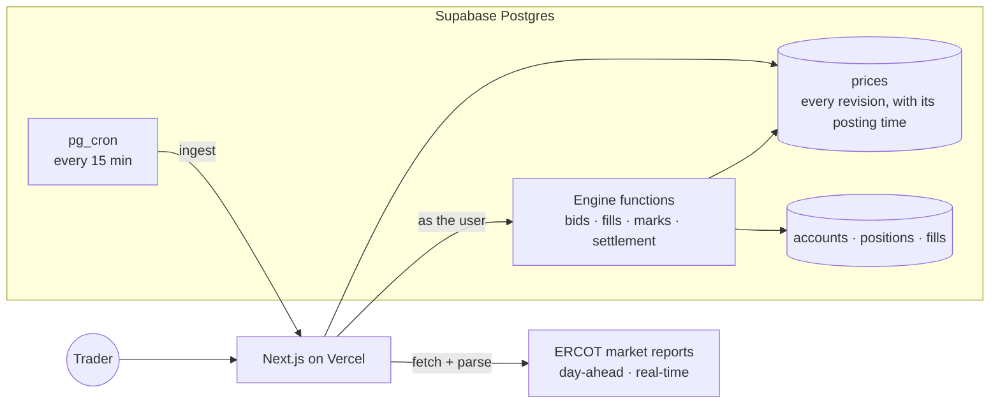

# PowerFlow

**Paper-trade the Texas power grid on real ERCOT prices.**

**[Open the live desk](https://powerflow-two.vercel.app)** ·
[How the market works](https://powerflow-two.vercel.app/learn) ·
[Building it](https://powerflow-two.vercel.app/engineering)


## Why I built it

I wanted to understand how a power trader actually works. Reading about ERCOT
only got me so far: an auction that closes before anyone knows the price, a
second market that prices the same hour again as it happens, and settlement
two business days later at prices that can still be corrected.

So I built the desk, wired it to ERCOT's real prices and rules, and started
bidding. Most of what I learned came from getting the details right.

## The trade

ERCOT prices every hour of Texas electricity twice. The **day-ahead market**
clears an auction for tomorrow, today. The **real-time market** prices the
same hour again as it is delivered. A cold snap, a plant trip or a windy night
pulls the two apart.

On November 11, 2026, power in the Panhandle cleared at **$84/MWh** day-ahead
for 9 PM. When 9 PM came, it traded at **$519**. A trader who had bought
10 MW the day before and sold it back in real time made about $4,350 on one
hour. That bet on the gap is a virtual bid, and it is what PowerFlow lets you
make, with $100,000 of pretend money:

- **You bid blind, as ERCOT requires.** Bids close at 10:00 Central the day
  before and fill at the clearing price ERCOT publishes that afternoon.
- **You settle on ERCOT's calendar.** Positions are marked to real time as each
  hour runs and settle when ERCOT calls the prices final, two business days
  later.
- **The prices are real.** They come from ERCOT's public market reports every
  15 minutes. Only the money is simulated.

## Try it

1. [Create an account](https://powerflow-two.vercel.app/signup) with email or
   Google.
2. Open **Markets**, pick a hub and bid on tomorrow's hours before 10:00
   Central.
3. Your bid fills that afternoon. Watch it marked hour by hour the next day,
   then settle when ERCOT calls the prices final.

New to power markets? [How it works](https://powerflow-two.vercel.app/learn)
explains the market in five minutes.

## The desk


**Positions.** Every megawatt you hold, laid out by delivery hour and marked to
real time until ERCOT's prices are final.


**Analytics.** Return, win rate, best and worst trade and drawdown, worked out
from your settled fills.

## What was hard

The market is in the details, and each of these took a few tries to get right.

- **Prices change after they're published.** ERCOT posts a price, then
  sometimes corrects it. Every price is kept with the moment it was posted, and
  a fill or a mark only sees what had been posted by then, so a correction can't
  rewrite an earlier trade
  ([price engine](supabase/migrations/0021_asof_price_engine.sql),
  [tests](src/lib/trading/sql-replay.test.ts)).
- **ERCOT's calendar.** The 10:00 bid gate, no withdrawing a bid after it,
  final prices at 16:00 on the second business day with holidays counted, and
  the 23- and 25-hour days when daylight saving changes
  ([bid gate](supabase/migrations/0038_dam_bid_deadline.sql),
  [calendar](supabase/migrations/0044_settlement_calendar.sql),
  [tests](src/lib/ercot/settlement-calendar.test.ts)).
- **A missing price is not zero.** An hour ERCOT hasn't priced yet is never
  filled or settled at an old price or at $0. It waits
  ([strict pricing](supabase/migrations/0011_strict_pricing.sql)).
- **The money has to add up.** Amounts are exact decimals, never floats
  ([`money.ts`](src/lib/money.ts)). Fills can only be added, and every hour each
  account is checked against its own fill history, with the result public on
  the [status page](https://powerflow-two.vercel.app/status)
  ([reconciliation](supabase/migrations/0054_ledger_reconciliation.sql)).
- **Two clicks, one trade.** Trades run inside Postgres, one account at a time,
  so a double-click or a second tab can't spend the same cash twice
  ([concurrency tests](src/lib/trading/sql-concurrency.test.ts)).

The full set of rules is in the [design reference](docs/design.md), and the
trader's-eye view of the market is in
[`docs/power-trading-industry.md`](docs/power-trading-industry.md).

<details>
<summary>How it fits together</summary>

A Next.js app on Vercel, with the trading engine written as Postgres functions
in Supabase. `pg_cron` pulls ERCOT's reports every 15 minutes and settles what
has become final.



Changes ship by pull request. CI applies every migration to a fresh database
and runs the engine tests against live ERCOT data, and a scheduled job checks
the live site after each deploy.

</details>

<details>
<summary>Run it locally</summary>

```bash
npm install
cp .env.example .env    # Supabase URL and keys; see docs/design.md
npm run dev             # http://localhost:3000
npm test                # offline suites
npm run test:db         # engine suites against a real database
```

To run the database suites the way CI does, start a disposable local stack
with `npx supabase start` and point the suites at it. Setup and scripts are in
the [design reference](docs/design.md).

| Path | What lives there |
| --- | --- |
| `supabase/migrations/` | The schema and the engine, as forward-only migrations |
| `src/lib/trading/` | The engine's rules in TypeScript for previews and analytics, pinned to the SQL by tests |
| `src/lib/ercot/` | ERCOT report parsing, hour-ending and daylight-saving handling, the settlement calendar |
| `src/app/` | Pages and API routes |
| `docs/` | Design reference and market notes |

</details>

## Author

Built by **[Sriharsha Challangi](https://github.com/Devligan)**.

Market data is published by ERCOT. This is a simulation for learning: no real
orders, no real money, not investment advice. Copyright © 2026 Sriharsha
Challangi, all rights reserved (see [LICENSE](LICENSE)).
