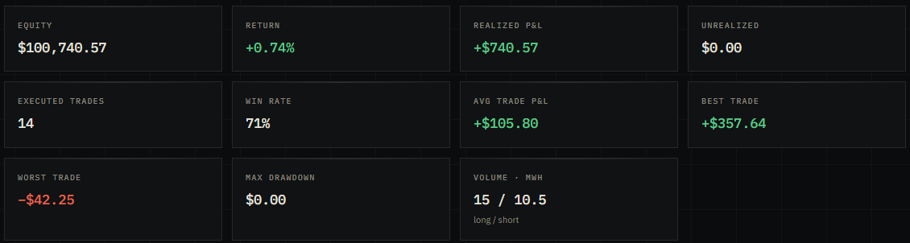
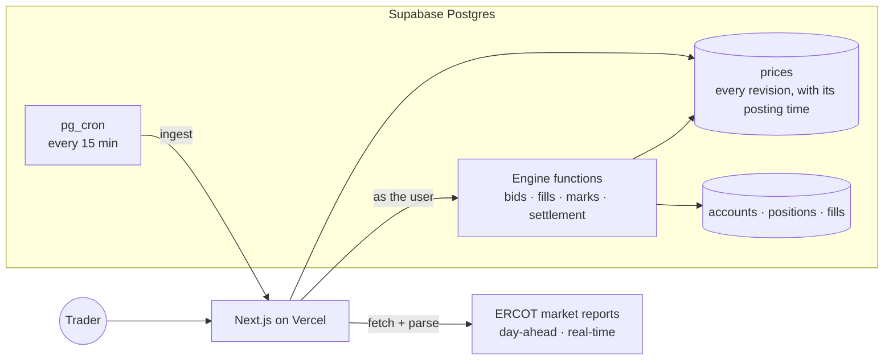

# PowerFlow

**Paper-trade the Texas power grid on real ERCOT prices.**

**[Open the live desk](https://powerflow-two.vercel.app)** ·
[How the market works](https://powerflow-two.vercel.app/learn) ·
[Methodology](https://powerflow-two.vercel.app/methodology)


## The trade

ERCOT prices every hour of Texas electricity twice. The **day-ahead market**
clears an auction for tomorrow, today. The **real-time market** prices the
same hour again as it is delivered. A cold snap, a plant trip or a windy night
pulls the two apart.

On November 11, 2026, power in the Panhandle cleared at **$84/MWh** day-ahead
for 9 PM. When 9 PM came, it traded at **$519**. A trader who had bought
10 MW the day before and sold it back in real time made about $4,350 on one
hour. That bet on the gap is a virtual bid, and PowerFlow is a desk for making it,
with $100,000 of virtual cash:

- **You bid blind, as ERCOT requires.** Bids close at 10:00 Central the day
  before and fill at the clearing price ERCOT publishes that afternoon.
- **You settle on ERCOT's calendar.** Positions are marked to real time as each
  hour runs and settle when ERCOT calls the prices final, two business days
  later.
- **The prices are real.** They come from ERCOT's public market reports every
  15 minutes. Only the money is simulated.

## Try it

1. [Create an account](https://powerflow-two.vercel.app/signup) with email or
   Google.
2. Open **Markets**, pick a hub and bid on tomorrow's hours before 10:00
   Central.
3. Your bid fills that afternoon. Watch it marked hour by hour the next day,
   then settle when ERCOT calls the prices final.

New to power markets? [How it works](https://powerflow-two.vercel.app/learn)
explains the market in five minutes.

## The desk


**Positions.** Every megawatt you hold, laid out by delivery hour and marked to
real time until ERCOT's prices are final.



**Analytics.** Return, win rate, best and worst trade and drawdown, worked out
from your settled fills.

## Methodology

- **Bids close at the gate.** An operating day takes bids from midnight Central
  fourteen days before it until 10:00 Central the day before, in steps of
  0.1 MW. A bid can be cancelled until the gate and not after.
- **Fills at the clearing price.** A bid fills at the day-ahead price ERCOT
  publishes that afternoon. A limit bid fills only if the price crosses it.
- **Marked to real time.** Open positions are marked to ERCOT's real-time price
  as each hour is delivered, using only prices published by then. A later
  revision never rewrites an earlier fill or mark.
- **Settled when prices are final.** Real-time prices are final at 16:00
  Central on the second business day after the operating day, with ERCOT's
  holidays counted. Positions settle then, at any corrected price. Days with
  23 or 25 hours at the daylight-saving changes are handled.
- **No price, no fill.** An hour without a published price is never filled,
  marked or settled at an older price or at zero. It waits.
- **Exact accounting.** Money is exact to a millionth of a dollar, fills are
  permanent, and every account is checked against its fill history each hour,
  with the result on the [status page](https://powerflow-two.vercel.app/status).

The full rules are in the [design reference](docs/design.md), and the market
itself is described in
[`docs/power-trading-industry.md`](docs/power-trading-industry.md).

<details>
<summary>How it fits together</summary>

A Next.js app on Vercel, with the trading engine written as Postgres functions
in Supabase. `pg_cron` pulls ERCOT's reports every 15 minutes and settles what
has become final.



Changes ship by pull request. CI applies every migration to a fresh database
and runs the engine tests against live ERCOT data, and a scheduled job checks
the live site after each deploy.

</details>

<details>
<summary>Run it locally</summary>

```bash
npm install
cp .env.example .env    # Supabase URL and keys; see docs/design.md
npm run dev             # http://localhost:3000
npm test                # offline suites
npm run test:db         # engine suites against a real database
```

To run the database suites the way CI does, start a disposable local stack
with `npx supabase start` and point the suites at it. Setup and scripts are in
the [design reference](docs/design.md).

| Path | What lives there |
| --- | --- |
| `supabase/migrations/` | The schema and the engine, as forward-only migrations |
| `src/lib/trading/` | The engine's rules in TypeScript for previews and analytics, pinned to the SQL by tests |
| `src/lib/ercot/` | ERCOT report parsing, hour-ending and daylight-saving handling, the settlement calendar |
| `src/app/` | Pages and API routes |
| `docs/` | Design reference and market notes |

</details>

## Author

Built by **[Sriharsha Challangi](https://github.com/Devligan)**.

Market data is published by ERCOT. This is a simulation for learning: no real
orders, no real money, not investment advice. Copyright © 2026 Sriharsha
Challangi, all rights reserved (see [LICENSE](LICENSE)).
