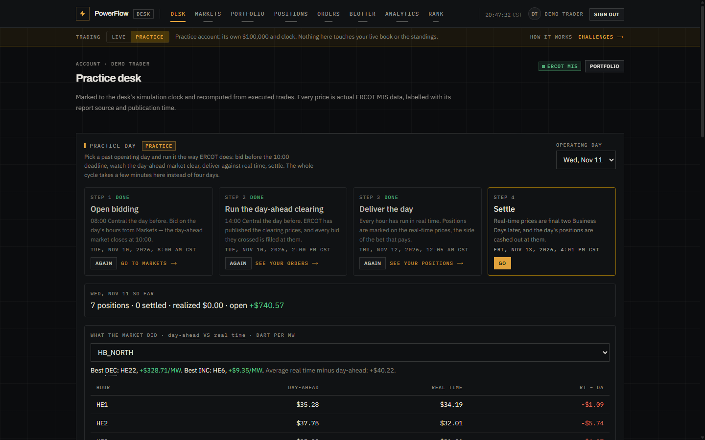
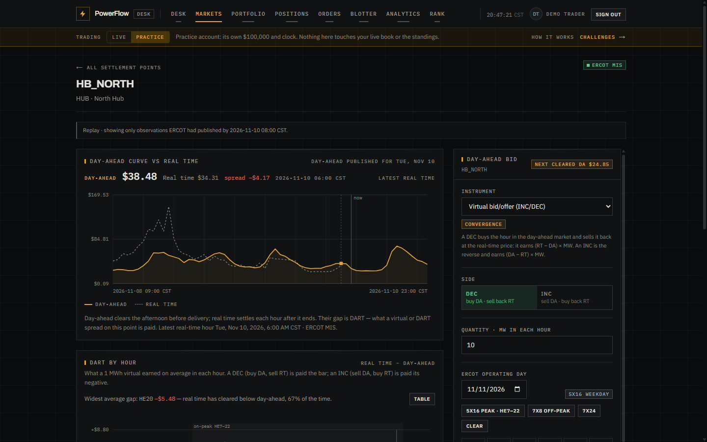
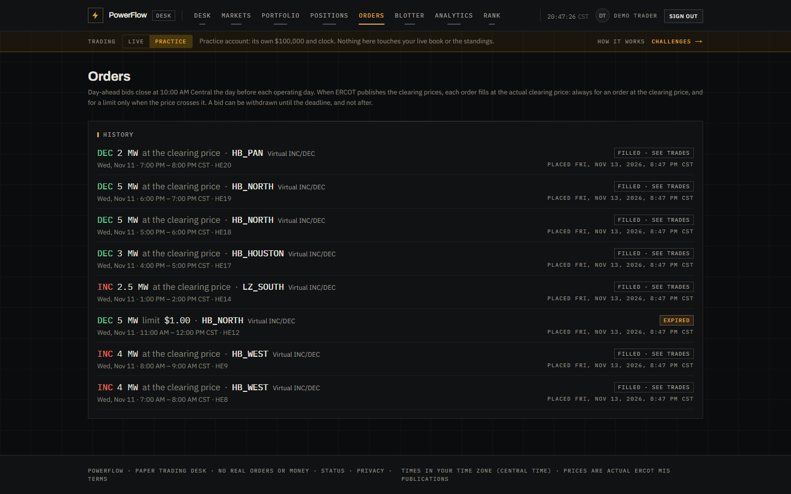
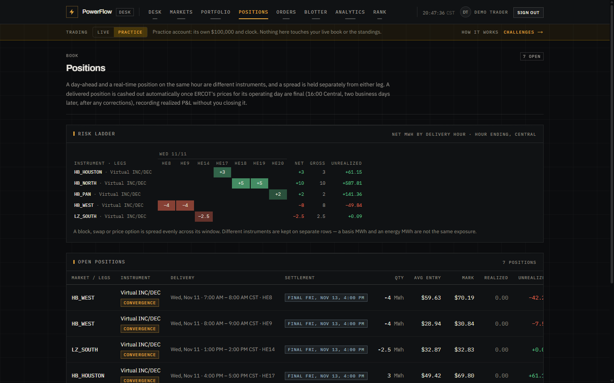
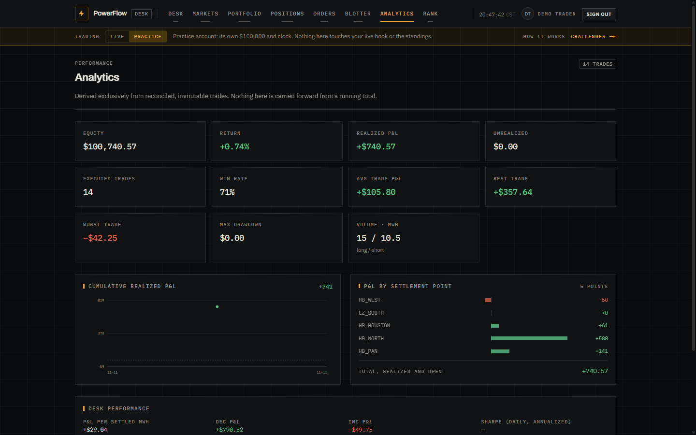
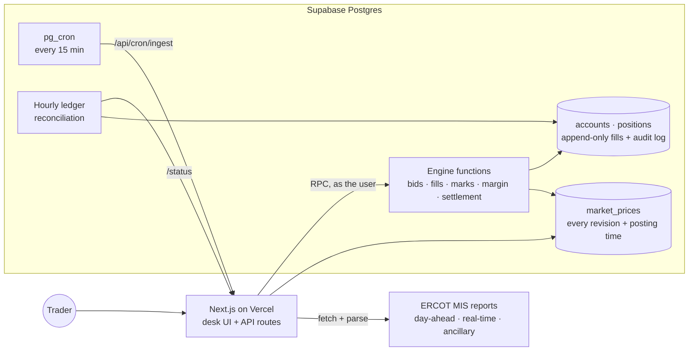

# PowerFlow

**Paper-trade the Texas power grid on real ERCOT prices.**

[](https://github.com/Devligan/powerflow/actions/workflows/ci.yml)
[](https://github.com/Devligan/powerflow/actions/workflows/production.yml)

**[Open the live desk](https://powerflow-two.vercel.app)** ·
[How it's built](https://powerflow-two.vercel.app/engineering) ·
[Live system status](https://powerflow-two.vercel.app/status) ·
[Design reference](docs/design.md)



## The trade

ERCOT prices every hour of Texas electricity twice. The **day-ahead market**
clears an auction for tomorrow, today. The **real-time market** prices the
same hour again as it is delivered. A heat wave, a plant trip or a windy night
pulls the two apart. That gap, the DART spread, is what a virtual trader bets
on.

PowerFlow is a desk for making that bet with $100,000 of virtual cash and
none of the shortcuts:

- **You bid blind, as ERCOT requires.** Bids close at 10:00 Central the day
  before delivery. They fill at the actual clearing price ERCOT publishes that
  afternoon, and a limit bid fills only if the price crosses it.
- **You settle on ERCOT's calendar.** Positions are marked on real-time prices
  as each hour runs. They settle when ERCOT calls those prices final, two
  business days later, at any corrected price.
- **The data is real.** Every price is ingested from ERCOT's public market
  reports every 15 minutes, with history back to September 2026. Only the
  money is simulated.

Waiting four days for a P&L is a slow way to learn, so the **practice desk**
replays a recent operating day with its own $100,000 and its own clock. You
bid, run the clearing, deliver the day and settle in about two minutes, and
your live account is never touched. **Challenges** put friends on the same
past days and rank them by P&L.

## Try it in two minutes

1. [Create an account](https://powerflow-two.vercel.app/signup) with email or
   Google.
2. Switch to **Practice** in the bar under the navigation and choose an
   operating day.
3. Open bidding, then place a few bids from **Markets**. For example, buy the
   evening peak at `HB_NORTH` (a DEC), betting that real time comes in above
   day-ahead.
4. Run the clearing, deliver the day and settle. The desk tells you which
   hours paid and why.

New to power markets? [How it works](https://powerflow-two.vercel.app/learn)
explains the market in five minutes.

## A day on the desk

| | |
| --- | --- |
|  |  |
| **Markets.** The day-ahead curve against real time for each hub and load zone, the average spread by hour, and the bid ticket. | **Orders.** Each bid fills at ERCOT's clearing price. The $1 limit bid never crossed, so it expired unfilled. |
|  |  |
| **Positions.** A risk ladder by delivery hour, and each position marked to real time until ERCOT's prices are final. | **Analytics.** Computed from the immutable fill history after settlement, never from a running total. |

## What makes it hard

A trading simulator is easy to build and easy to get subtly wrong. These are
the problems that decide whether one is worth practising on, and how PowerFlow
handles each one.

**No look-ahead.** Every price is stored with the moment ERCOT posted it,
revisions included. Every fill, mark and margin check reads prices *as of*
the account's own clock. A replay desk rewinds its clock, and the database,
not the UI, hides the future. See
[`0021_asof_price_engine.sql`](supabase/migrations/0021_asof_price_engine.sql)
and [`sql-replay.test.ts`](src/lib/trading/sql-replay.test.ts).

**ERCOT's rules, not a simplification of them.** These rules are enforced in
the engine, not just in the form:

- the 10:00 bid gate the day before;
- a 14-day bid window;
- the 0.1 MW quantity grid;
- no withdrawal after the gate;
- no trading once delivery starts;
- settlement at 16:00 Central on the second business day, holidays included,
  at ERCOT's corrected prices;
- 23- and 25-hour days at the daylight-saving changes.

See [`0038_dam_bid_deadline.sql`](supabase/migrations/0038_dam_bid_deadline.sql),
[`0044_settlement_calendar.sql`](supabase/migrations/0044_settlement_calendar.sql)
and [`settlement-calendar.test.ts`](src/lib/ercot/settlement-calendar.test.ts).

**No guessed prices.** An hour with no published price is never filled,
marked or settled at an older price or at zero. It waits, and the screen says
why.

**Exact money.** Postgres stores `numeric`, and the browser uses `bigint` at a
fixed scale of a millionth of a dollar. There are no floats anywhere in the
accounting path ([`money.ts`](src/lib/money.ts)).

**The database is the engine.** Fills, marks, margin, forced liquidation and
settlement are Postgres functions. Each runs in one transaction under a
per-account lock, so two tabs or a double-click cannot spend the same cash
twice. Orders are idempotent by client id. Fills and the audit log are
append-only, enforced by triggers. Row-level security and least-privilege
grants mean a browser session can call only the handful of functions it needs
and read only its own rows. These are proved against a real database in
[`sql-concurrency.test.ts`](src/lib/trading/sql-concurrency.test.ts) and
[`security.exploits.test.ts`](src/lib/security.exploits.test.ts).

**Books that prove themselves.** Every hour, `pg_cron` reconciles every
account against its fills in one read-only snapshot. It checks cash,
positions, settlements, bids and the audit trail. The result is public on
[/status](https://powerflow-two.vercel.app/status), and a failure fails the
Production workflow. Every engine test runs the same reconciliation before
teardown
([`0054_ledger_reconciliation.sql`](supabase/migrations/0054_ledger_reconciliation.sql)).

## How it fits together



The TypeScript in [`src/lib/trading/`](src/lib/trading) mirrors the SQL rules
for previews and analytics. It is pinned to the SQL by database-backed test
suites, so the two cannot drift apart unnoticed.

## How it ships

Every change reaches production through a pull request:

1. **CI** ([`ci.yml`](.github/workflows/ci.yml)) runs repository guards
   ([`ci-guards.mjs`](scripts/ci-guards.mjs)). They enforce append-only
   migrations, pinned `search_path` and revoked grants on every privileged
   function, and no mojibake. Then come zero-warning lint, type-check, the unit
   suites, the production build, a dependency audit and a secret scan. Last,
   **every migration is applied in order to a fresh Supabase stack**, and the
   engine suites run there against live ERCOT data.
2. **Migrations** are forward-only. Each one is rehearsed against production
   inside a rolled-back transaction, applied before the code that needs it,
   and recorded in a ledger table, so `--status` says exactly what production
   has.
3. **Vercel** deploys master.
4. **The Production workflow**
   ([`production.yml`](.github/workflows/production.yml)) runs
   [`smoke-production.mjs`](scripts/smoke-production.mjs) after every deploy
   and every six hours. It checks the live site, auth gating, data freshness,
   the ledger reconciliation and database headroom.

## Run it locally

```bash
npm install
cp .env.example .env    # Supabase URL and keys; see docs/design.md
npm run dev             # http://localhost:3000
npm test                # offline suites
npm run test:db         # engine suites against a real database
```

To run the database suites the way CI does, start a disposable local stack
with `npx supabase start` and point the suites at it. Setup, scripts and every
engine rule are in the [design reference](docs/design.md). The trader's-eye
view of the market is in
[`docs/power-trading-industry.md`](docs/power-trading-industry.md).

<details>
<summary>Repository map</summary>

| Path | What lives there |
| --- | --- |
| `supabase/migrations/` | The schema and the engine, as forward-only migrations; the latest one to touch a function defines it |
| `src/lib/trading/` | TypeScript mirror of the engine rules, plus the SQL-pinning test suites |
| `src/lib/ercot/` | ERCOT report adapters, hour-ending and DST handling, the settlement calendar |
| `src/lib/ingestion.ts` | Resumable, budgeted ingestion with gap-fill |
| `src/app/` | Pages (App Router) and API routes, which validate input and call the engine |
| `scripts/` | Migration runner, production smoke check, end-to-end checks, backfills, screenshots |
| `docs/` | Design reference, market notes, screenshots |

</details>

## Author

Built by **[Sriharsha Challangi](https://github.com/Devligan)**.

Market data is published by ERCOT. This is a simulation for education: no
real orders, no real money, not investment advice. Copyright © 2026 Sriharsha
Challangi, all rights reserved (see [LICENSE](LICENSE)).
